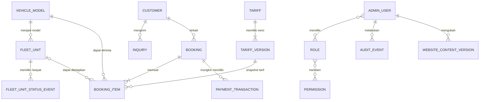
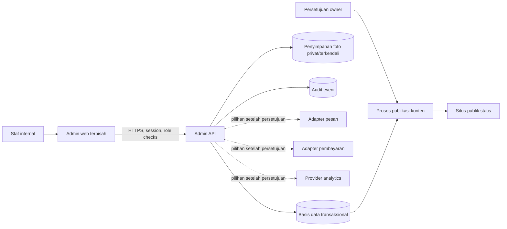

# Perencanaan Sistem Admin Anantalia Trans

**Fase:** Phase 2 — System Planning  
**Status:** Draft untuk keputusan pemilik  
**Tanggal:** 1 November 2026  
**Cakupan:** Rancangan kebutuhan, alur, model data, arsitektur, keamanan, dan kriteria sebelum implementasi. Dokumen ini tidak membangun dashboard atau mengubah situs publik.

## Ringkasan

Proyek saat ini adalah situs publik statis. Tidak ada API, basis data, autentikasi admin, booking yang tersimpan, data pelanggan, transaksi pembayaran, atau sumber analitik yang terhubung. Karena itu, admin yang direncanakan harus diperlakukan sebagai sistem baru yang kebutuhannya masih perlu disetujui pemilik.

`fleet.json` berisi 63 record katalog bertanda dummy dengan `entryType: vehicle-model`. Record tersebut menggambarkan model untuk prototipe, bukan 63 kendaraan fisik yang dimiliki atau tersedia. Sistem mendatang perlu membedakan model katalog dari unit kendaraan nyata.

Rekomendasi awal adalah memisahkan aplikasi admin dari situs publik, menyimpan data operasional dalam layanan server dan basis data transaksional, serta menerbitkan hanya konten yang disetujui ke situs publik. Pilihan stack, vendor, hosting, dan integrasi belum ditetapkan. Pemilik perlu menyetujui keputusan inti di bagian 14 sebelum Phase 3 dimulai.

## 1. Fakta proyek dan sumber

| Fakta yang diperiksa | Kondisi saat ini | Sumber |
|---|---|---|
| Situs publik | Lima halaman statis HTML, CSS, dan JavaScript; Tailwind sudah dikompilasi lokal pada Phase 1. | [README](../README.md), [Arsitektur situs](architecture.md), [Laporan stabilisasi](stabilization-report.md) |
| Backend admin | Tidak ditemukan API, autentikasi admin, basis data, atau layanan operasional admin pada proyek saat ini. | Struktur proyek dan dokumentasi Phase 1 |
| Data katalog | `fleet.json` menjadi sumber katalog tunggal berisi 63 ID unik; seluruh data masih dummy. | [`fleet.json`](../fleet.json), [Laporan stabilisasi](stabilization-report.md) |
| Materi admin | Kit menyediakan sistem visual dan spesifikasi layar sebagai brief/proposal, bukan bukti kebutuhan atau alur operasional yang sudah disetujui. | [Design system kit](../anantalia_trans_admin_full_stitch_kit/anantalia_trans_admin_full_stitch_kit/design_system.md), [Screen spec kit](../anantalia_trans_admin_full_stitch_kit/anantalia_trans_admin_full_stitch_kit/screen_spec.md), [Prompt kit](../anantalia_trans_admin_full_stitch_kit/anantalia_trans_admin_full_stitch_kit/stitch_prompt.md) |
| Referensi desain yang disebut kit | Screenshot TailAdmin dan `AI_UI_STYLE_CLONER_STITCH(4).md` tidak ditemukan pada file yang diekstrak. Proporsi yang diklaim berasal dari referensi itu belum dapat diverifikasi dari workspace. | Pemeriksaan isi folder kit |
| Fakta bisnis publik | Nomor kontak lama dan beberapa informasi publik masih perlu konfirmasi pemilik. Tarif, spesifikasi, status, dan katalog tetap data dummy. | [Laporan stabilisasi](stabilization-report.md), [Kemajuan Phase 1](implementation-progress.md) |

Token dan arah visual dari kit—teal `#006764`, aksen `#00827E`, latar `#F7F8F6`, mint `#EAF6F4`, font Manrope—dapat menjadi titik awal desain admin. Token tersebut adalah arahan desain, bukan persetujuan implementasi. Identitas situs publik tetap dipertahankan dan tidak menjadi alasan untuk merombak tampilannya.

## 2. Tujuan dan batas fase

### Tujuan

- Menentukan pengguna, hak akses, proses inti, dan sumber data yang perlu disetujui.
- Memisahkan konsep model kendaraan dari unit fisik, permintaan pelanggan, pemesanan, tarif, dan pembayaran.
- Menetapkan keputusan arsitektur dan kontrol keamanan sebelum pekerjaan UI atau backend.
- Menentukan kriteria penerimaan sehingga data dummy tidak tercampur dengan data operasional.

### Di luar cakupan

- Tidak membuat dashboard, halaman admin, API, autentikasi, atau migrasi data pada dokumen ini.
- Tidak mengubah situs publik, katalog, atau berkas `desain.md` dan `docs/audit-project-2026-11-01.md`.
- Tidak menganggap WhatsApp, pembayaran, pesan masuk, analytics, atau publikasi konten sudah terintegrasi.
- Tidak menetapkan klaim perusahaan, tarif, kebijakan, kepemilikan armada, atau alur bisnis sebagai fakta.

## 3. Modul yang diusulkan

Kit mendefinisikan sepuluh layar. Tabel ini memetakan ruang lingkup usulan dan prasyaratnya.

| Modul kit | Prioritas rancangan | Prasyarat sebelum data nyata ditampilkan |
|---|---|---|
| Dashboard | Ringkasan setelah sumber data dan definisi KPI tersedia. | Data pemesanan/armada terhubung; rumus dan rentang periode disetujui. Tanpa sumber data, tampilkan kosong, bukan angka contoh seolah nyata. |
| Manajemen Armada | Inti awal setelah model dan unit fisik dipisah. | Daftar unit terverifikasi, status operasional, tarif yang disahkan, hak edit. |
| Pemesanan | Inti setelah proses permintaan dan konfirmasi disepakati. | Definisi permintaan vs booking terkonfirmasi, status, perubahan, dan pembatalan. |
| Pelanggan | Bergantung pada persetujuan pengelolaan data pribadi. | Tujuan pengumpulan, akses berbasis peran, retensi dan penghapusan. |
| Keuangan | Tahap lanjut. | Definisi transaksi, sumber data pembayaran, rekonsiliasi dan akses terbatas. Tidak menghitung laba tanpa data biaya. |
| Harga & Tarif | Setelah pemilik menyetujui nilai dan aturan harga. | Satuan, paket, masa berlaku, pajak/biaya bila relevan, persetujuan perubahan. |
| Konten Website | Setelah alur review/publikasi dan batas konten ditetapkan. | Peran editor dan penyetuju; preview; rollback; nilai publik terverifikasi. |
| Pesan Masuk | Tahap lanjut setelah kanal dan proses masuk dipilih. | Integrasi kanal nyata atau penjelasan bahwa pesan masih berupa input manual. |
| Analytics | Tahap lanjut setelah provider dan definisi metrik disetujui. | Sumber analitik terhubung, persetujuan privasi/cookie bila diperlukan, rentang retensi. |
| Pengaturan | Terbatas ke pengaturan akun/admin yang benar-benar diperlukan. | Kebijakan identitas, sesi, notifikasi, konfigurasi dan siapa yang berwenang mengubahnya. |

Nama dan rute `/admin/...` yang ada di kit hanya proposal. Rute final mengikuti pilihan framework dan sistem autentikasi yang disetujui.

## 4. Aktor dan matriks izin awal

Peran di bawah ini adalah usulan least privilege, bukan daftar jabatan perusahaan yang sudah dikonfirmasi. Pemilik perlu mengesahkan siapa yang benar-benar menggunakan sistem. Semua izin wajib ditegakkan server-side pada setiap permintaan, bukan hanya dengan menyembunyikan tombol UI.

| Kapabilitas | Owner | Operations | Finance | Content Editor | Read-only Auditor |
|---|---:|---:|---:|---:|---:|
| Membaca dashboard operasional | Ya | Ya | Terbatas | Tidak | Ya |
| Mengelola model/unit dan status | Ya | Ya | Tidak | Tidak | Baca |
| Meninjau permintaan dan booking | Ya | Ya | Baca nilai yang perlu | Tidak | Baca terbatas |
| Mengelola data pelanggan | Ya | Sesuai tugas | Tidak | Tidak | Baca terbatas |
| Mengelola tarif | Setujui | Usul/edit draft | Baca atau setuju bila ditunjuk | Tidak | Baca |
| Melihat/mengelola transaksi | Ya | Tidak | Ya | Tidak | Baca terbatas |
| Mengedit konten publik | Setujui/publikasi | Tidak | Tidak | Edit draft | Baca |
| Kelola akun dan peran | Ya | Tidak | Tidak | Tidak | Tidak |
| Membaca audit log | Ya | Terbatas | Terbatas | Tidak | Ya |

Implementasi harus menolak akses secara default, memeriksa izin untuk setiap resource/aksi, dan merekam perubahan kritis. Pemisahan maker-checker untuk tarif, publikasi konten, atau status booking perlu diputuskan pemilik. Jika tim kecil membuat pemisahan peran tidak praktis, risiko dan prosedur pengganti harus dicatat.

## 5. Model data kandidat

Ini model konseptual untuk divalidasi, bukan skema final. Relasi, kolom, aturan unik, dan retensi memerlukan keputusan bisnis serta teknis.

| Entitas kandidat | Peran dan batas data |
|---|---|
| `vehicle_model` | Informasi jenis/model katalog. Migrasi awal dapat memetakan 63 ID dummy dari `fleet.json` ke tabel staging/katalog. Data dummy harus ditandai dan tidak otomatis dipublikasikan sebagai inventaris nyata. |
| `fleet_unit` | Satu kendaraan fisik yang sudah diverifikasi, terpisah dari model. Nomor registrasi/identifikasi adalah data sensitif operasional dan aksesnya perlu dibatasi. Jumlah unit tidak boleh disimpulkan dari model katalog. |
| `fleet_unit_status_event` | Riwayat perubahan status unit jika pemilik memerlukan ketersediaan yang dapat diaudit. Status final dan siapa yang dapat mengubahnya perlu disepakati. |
| `tariff` / `tariff_version` | Nilai dan aturan tarif yang disetujui dengan tanggal efektif. Perubahan membuat versi baru; snapshot tarif pada pemesanan lama tidak berubah. |
| `customer` | Kontak pelanggan yang memang diperlukan untuk menindaklanjuti permintaan/pemesanan. Kumpulkan data minimum dan tetapkan retensi. |
| `inquiry` | Pesan/minat yang belum menjadi booking. Kanal masuk, persetujuan penyimpanan, serta status tindak lanjut perlu ditentukan. |
| `booking` / `booking_item` | Permintaan yang statusnya menjadi booking hanya berdasarkan aturan konfirmasi pemilik. Item dapat merujuk unit atau model sesuai proses yang disetujui. Snapshot jadwal dan tarif disimpan. |
| `payment_transaction` | Catatan referensi dan status dari provider bila pembayaran digital benar-benar dipilih. Jangan menyimpan data kartu pembayaran di aplikasi. |
| `admin_user`, `role`, `permission` | Akun staf, status akun, relasi peran, dan izin. Penghapusan/penonaktifan akun harus tetap menjaga atribusi audit. |
| `audit_event` | Aktor, aksi, resource, waktu, hasil, dan ringkasan perubahan kritis. Hindari menyimpan kata sandi, token, data pembayaran sensitif, atau isi PII berlebihan di log. |
| `website_content_version` | Draft dan revisi konten yang disetujui untuk diterbitkan, dengan versi, aktor, status, dan waktu publikasi. |
| `integration_config` | Referensi integrasi dan status koneksi tanpa menaruh rahasia pada browser atau repository. Rahasia perlu secret manager yang dipilih saat desain teknis. |

Relasi tingkat tinggi:

Garis model dan unit pada diagram adalah relasi kandidat. Pemilihan unit bisa terjadi sebelum atau setelah konfirmasi menurut aturan bisnis; hal ini belum diketahui.

## 6. Alur kerja yang perlu disepakati

### Armada

Usulan alur data: `draft` → verifikasi pemilik → `active` di katalog. Status unit fisik terpisah, misalnya tersedia, dipesan, perawatan, atau tidak aktif. Label dan transisi final wajib mengikuti istilah operasional yang digunakan pemilik. Model dummy dari `fleet.json` tetap berlabel dummy sampai diverifikasi; statusnya tidak membuat unit fisik.

### Permintaan dan pemesanan

Usulan alur awal: `inquiry` → penawaran disiapkan → menunggu keputusan pelanggan → dikonfirmasi → berlangsung → selesai. Status ditolak/dibatalkan dapat ditambahkan setelah pemilik menentukan siapa yang dapat memutuskan, alasan, notifikasi, tenggat, dan dampak finansial. Status `confirmed` harus memiliki kondisi eksplisit dan jejak aktor. Jangan terapkan kebijakan deposit, refund, biaya pembatalan, atau SLA sebelum ada keputusan tertulis.

Saat permintaan belum memiliki data operasional yang cukup, sistem perlu memisahkan `inquiry` dari `booking` terkonfirmasi. Tautan WhatsApp di situs sekarang bukan bukti integrasi inbox atau penyimpanan otomatis.

### Tarif

Usulan: tarif baru disimpan sebagai draft, diverifikasi oleh pihak berwenang, lalu memiliki tanggal efektif dan versi. Setiap booking menyimpan snapshot harga dan aturan yang dipakai saat disetujui agar perubahan tarif berikutnya tidak mengubah transaksi historis.

### Konten publik

Usulan: `draft` → `in review` → `approved` → `published`, dengan rollback ke versi sebelumnya. Hanya editor yang ditunjuk dapat mengubah draft; publikasi klaim, kontak, layanan, tarif, atau legalitas memerlukan bukti dan persetujuan owner. Mekanisme sinkronisasi ke situs publik perlu dipilih: build/export saat deployment atau API read-only. Jangan memberi browser publik kemampuan menulis ke data operasional.

## 7. Arsitektur target yang disarankan

### Keputusan yang direkomendasikan

- Tempatkan admin di aplikasi/rute terpisah dari situs publik; jangan masukkan rahasia atau logika admin ke JavaScript publik.
- Gunakan API server sebagai boundary validasi, otorisasi, transaksi, dan audit. Framework bahasa/server belum dipilih.
- Gunakan basis data relasional sebagai kandidat karena booking, perubahan status, snapshot tarif, dan transaksi memerlukan konsistensi. PostgreSQL dapat dievaluasi, tetapi belum dipilih.
- Pertahankan situs publik sebagai situs statis selama sesuai. Alirkan katalog/konten yang telah disetujui melalui proses build/publikasi atau endpoint baca yang terkontrol setelah kebutuhan deployment dipahami.
- Simpan foto yang diunggah di object storage atau media store terkelola setelah hosting dipilih. Validasi format/ukuran, nama acak, hak akses, dan pemindaian sesuai kebutuhan.
- Buat adapter per integrasi supaya WhatsApp, email, payment gateway, dan analytics dapat dipilih kemudian tanpa mengikat domain bisnis pada provider yang belum disetujui.
- Jangan menyimpan secret, token, atau kredensial di repo, bundle browser, maupun file JSON publik.

### Keamanan dan privasi sebagai baseline desain

- MFA dianjurkan untuk semua akun admin, terutama owner dan akun yang dapat mengelola user, pembayaran, tarif, atau publikasi. Pilih opsi yang sesuai skala dan perangkat tim. NIST menganjurkan opsi autentikasi tahan phishing pada tingkat assurance terkait bila praktis; keputusan teknis akhir perlu mempertimbangkan ancaman dan dukungan provider. [NIST SP 800-63B](https://pages.nist.gov/800-63-4/sp800-63b/authenticators/)
- Gunakan sesi server-side atau mekanisme sesi framework yang terpelihara, cookie aman, rotasi/invalidation sesi, timeout, dan proteksi CSRF sesuai pola autentikasi. Jangan menaruh PII atau hak akses dalam token client yang dipercaya sebagai sumber otorisasi. [OWASP Session Management Cheat Sheet](https://cheatsheetseries.owasp.org/cheatsheets/Session_Management_Cheat_Sheet.html)
- Terapkan penolakan default, pemeriksaan izin server-side pada setiap request/resource, dan pengujian akses lintas role. [OWASP Authorization Cheat Sheet](https://cheatsheetseries.owasp.org/cheatsheets/Authorization_Cheat_Sheet.html)
- Catat login sukses/gagal, perubahan role, tarif, booking, publikasi, dan aksi sensitif lain. Redaksi secret dan PII; tetapkan siapa yang dapat membaca log serta lama penyimpanannya. [OWASP Logging Cheat Sheet](https://cheatsheetseries.owasp.org/cheatsheets/Logging_Cheat_Sheet.html)
- Tetapkan pengumpulan data minimum, dasar/tujuan penggunaan, hak akses, retensi, backup, dan proses penghapusan sebelum menyimpan data pelanggan nyata.
- Rancang backup otomatis dan uji pemulihan. Backup yang belum pernah diuji restore bukan bukti pemulihan siap.

## 8. API kandidat

Semua endpoint berikut hanya contoh resource contract, bukan API yang sudah tersedia atau komitmen nama final. Versi, format error, pagination, idempotency, dan aturan konkurensi perlu ditentukan dalam Phase 3.

| Resource kandidat | Operasi awal | Catatan kontrol |
|---|---|---|
| `/api/v1/admin/session` | login, logout, sesi aktif | Rate limit, CSRF bila cookie session, MFA sesuai keputusan. |
| `/api/v1/admin/vehicle-models` | daftar, detail, buat/edit draft | Dummy vs terverifikasi harus eksplisit; edit tercatat. |
| `/api/v1/admin/fleet-units` | daftar, detail, buat/edit status | Hanya kendaraan fisik terverifikasi; izin operasi. |
| `/api/v1/admin/tariffs` | daftar, draft versi, setuju/aktifkan | Persetujuan dan tanggal efektif; simpan versi lama. |
| `/api/v1/admin/inquiries` | daftar, detail, ubah tindak lanjut | Akses data kontak dibatasi. |
| `/api/v1/admin/bookings` | daftar, detail, transisi yang diizinkan | Validasi transisi di server; idempotency untuk operasi yang diulang. |
| `/api/v1/admin/content-versions` | draft, preview, approve, publish, rollback | Hanya publikasi yang disetujui dapat disalin ke situs publik. |
| `/api/v1/admin/users` dan `/roles` | kelola akun/izin | Owner-only; semua perubahan dicatat. |
| `/api/v1/admin/audit-events` | baca/filter | Read-only dan akses terbatas; data sensitif disamarkan. |

API publik, jika dibutuhkan untuk katalog, harus terpisah dari endpoint admin, hanya membaca data yang disetujui, dan tidak mengekspos PII/internal status.

## 9. Keputusan dan pertanyaan untuk pemilik

Pertanyaan berikut memblokir rancangan skema final atau implementasi yang berisiko. Tidak ada jawaban yang diasumsikan di dokumen ini.

| Area | Keputusan yang diperlukan |
|---|---|
| Pemakai | Siapa yang akan menggunakan admin? Berapa owner/admin, operator, finance, editor, dan auditor yang diperlukan? Apakah orang dapat memiliki lebih dari satu peran? |
| Armada aktual | Apa daftar unit fisik terverifikasi dan sumber data resminya? Apakah inventaris dikelola per unit atau hanya model? Siapa memperbarui status? |
| Harga | Siapa yang menetapkan dan menyetujui harga? Satuan, paket, masa berlaku, biaya tambahan dan snapshot booking seperti apa yang berlaku? |
| Permintaan/booking | Kapan permintaan menjadi booking? Siapa dapat mengonfirmasi, mengubah, menolak, atau membatalkan? Aturan deposit/refund/notifikasi apa yang telah disahkan? |
| Pelanggan | Data apa yang benar-benar dibutuhkan, tujuan pemakaian, retensi, akses, koreksi, serta penghapusannya bagaimana? |
| Konten publik | Siapa menulis, memeriksa bukti, menyetujui, dan menerbitkan? Seberapa cepat perubahan harus tampil di situs? |
| Integrasi | Apakah input tetap melalui WhatsApp/manual, atau dibutuhkan inbox/API? Apakah pembayaran digital dan analytics dibutuhkan? Provider mana yang sudah dimiliki/diizinkan? |
| Keuangan | Apa definisi pendapatan, pembayaran tertunda, transaksi selesai, biaya, dan rekonsiliasi? Sistem keuangan sumbernya di mana? |
| Operasional | Jam kerja, zona waktu, pemberitahuan, SLA, pembatalan, biaya, dan eskalasi mana yang resmi? |
| Hosting | Domain admin, lokasi hosting/database, backup, logging, environment, dan proses deployment apa yang tersedia? |
| Security owner | Siapa menyetujui daftar akun, MFA, role, pemulihan akun, dan peninjauan akses berkala? |

## 10. Risiko dan pengendalian awal

| Risiko | Dampak | Pengendalian yang disarankan |
|---|---|---|
| Data 63 model dummy dibaca sebagai 63 unit nyata | Ketersediaan atau kapasitas bisnis salah ditampilkan. | Pisahkan `vehicle_model` dan `fleet_unit`, beri status sumber/verifikasi, dan larang KPI unit dari jumlah model. |
| Booking dianggap terkonfirmasi terlalu dini | Konflik jadwal, kerugian, atau janji kepada pelanggan. | Definisikan status/transisi dan hak konfirmasi; simpan audit trail dan aturan harga snapshot. |
| Klaim/harga belum disahkan terbit ke publik | Informasi publik menyesatkan. | Approval konten, bukti owner, publikasi versi, dan rollback. |
| Data pelanggan tersebar atau tersimpan terlalu lama | Paparan privasi dan akses tanpa kebutuhan. | Minimalkan pengumpulan, batasi role, tetapkan retensi/penghapusan dan akses log. |
| Role hanya dibatasi pada tampilan UI | Pengguna dapat memanggil API langsung. | Otorisasi server-side pada setiap aksi/resource serta tes role negatif. |
| Integrasi dummy dianggap nyata | Operator mengandalkan pesan/pembayaran yang tidak masuk ke sistem. | Label prototipe; jangan tampilkan status koneksi sukses tanpa integrasi teruji. |
| Kehilangan data saat insiden | Pemesanan/operasional tidak dapat dipulihkan. | Backup terjadwal, target RPO/RTO yang disetujui, dan simulasi restore. |
| Scope terlalu luas untuk tahap awal | Implementasi lambat dan risiko tinggi. | Mulai dari akun/akses, data armada terverifikasi, tarif dan inquiry; tambah keuangan/analytics setelah sumber tersedia. |

## 11. Kriteria penerimaan sebelum UI atau backend dibuat

Phase 2 dinyatakan siap masuk Phase 3 setelah pemilik dan tim terkait menyetujui atau secara eksplisit menunda setiap butir berikut:

- Peran dan izin awal disetujui beserta pemilik akses dan proses penonaktifan akun.
- Sumber data unit fisik dan proses verifikasi katalog diketahui; record dummy dipisahkan dari data operasional.
- Alur inquiry/booking, status, siapa yang menyetujui transisi, dan aturan harga dibukukan.
- Keperluan data pelanggan, hak akses, retensi, backup, dan penghapusan diputuskan.
- Jalur edit/review/publikasi konten dan mekanisme sinkronisasi situs publik disepakati.
- Hosting, arsitektur aplikasi/API/database, domain admin, dan pilihan integrasi dipilih atau dicatat sebagai keputusan tertunda dengan pemilik dan tanggal target.
- Kontrol autentikasi, sesi, otorisasi, audit, secret, backup/restore, dan respons insiden dirinci dalam desain teknis.
- Metrik dashboard/keuangan/analytics mempunyai sumber dan rumus yang disepakati; jika belum, modul menampilkan keadaan kosong, bukan angka fiktif.
- Kontrak API, migrasi, strategi lingkungan, dan rencana pengujian disiapkan sebelum data produksi digunakan.
- Tidak ada klaim bahwa UI menyimpan atau mengirim data sebelum backend/integrasi nyata tersedia.

## 12. Rekomendasi urutan Phase 3 dan seterusnya

1. **Phase 3 — Technical Foundation & Access:** finalkan hosting dan stack, CI/environment, auth/session, role enforcement, audit log, backup dan restore; buat keputusan keamanan sebelum UI admin.
2. **Phase 4 — Verified Fleet & Tariff:** masukkan model dan unit fisik yang sudah disahkan, impor dengan pemeriksaan 63 ID sumber, versi tarif, status operasional, histori dan persetujuan.
3. **Phase 5 — Inquiry & Booking Workflow:** tentukan sumber permintaan, transisi status, jadwal, penawaran, snapshot tarif, notifikasi serta kondisi konfirmasi.
4. **Tahap lanjutan:** pelanggan, keuangan, inbox, editor publik, dan analytics hanya setelah tujuan, sumber, integrasi, privasi dan rumusnya disetujui.
5. Buat UI per alur prioritas setelah kontrak API dan data tersedia; jalankan uji akses role, interaksi, browser desktop/mobile, dan uji pemulihan sesuai lingkup implementasi.

Urutan ini rekomendasi perencanaan. Pemilik dapat mengubah prioritas setelah fakta operasional dan batas sumber daya tersedia.

## 13. Batas dan pekerjaan yang belum diselesaikan

- Peran, proses, kebijakan, tarif, unit fisik, data pelanggan, pembayaran, dan sumber analytics belum dikonfirmasi.
- Tidak ada vendor, framework backend, DBMS, hosting, identity provider, storage, atau kanal integrasi yang dipilih.
- Materi kit menyebut referensi desain eksternal yang tidak ada di folder kit; gunakan token desain yang tercantum sebagai arahan saja sampai pemilik memberi aset/screenshot referensi.
- Dokumen ini belum merupakan threat model formal, kajian hukum/privasi, desain deployment, skema database final, spesifikasi OpenAPI, atau estimasi biaya.
- Validasi visual/browser belum relevan untuk dokumen perencanaan ini; pengujian implementasi wajib dilakukan pada fase pembangunan dan tidak boleh digantikan oleh validator statis.

## 14. Log keputusan

| ID | Keputusan/isu | Status | Penanggung jawab |
|---|---|---|---|
| D-01 | Bedakan model katalog dan kendaraan fisik | Direkomendasikan; perlu pengesahan pemilik | Pemilik operasional |
| D-02 | Aplikasi admin terpisah dari situs publik | Direkomendasikan; perlu persetujuan hosting | Pemilik/teknis |
| D-03 | Basis data relasional untuk transaksi | Kandidat; keputusan setelah kebutuhan dan hosting dikaji | Teknis/pemilik |
| D-04 | Peran serta matriks izin pada bagian 4 | Usulan; menunggu daftar pengguna dan persetujuan | Pemilik |
| D-05 | Status inquiry, booking, pembatalan, tarif | Belum diputuskan | Pemilik operasional |
| D-06 | Provider pesan, pembayaran, analytics | Belum diputuskan | Pemilik |
| D-07 | Retensi, penghapusan, backup, RPO/RTO | Belum diputuskan | Pemilik/teknis |
| D-08 | Mekanisme publikasi konten ke situs statis | Pilih build/export atau API baca saat hosting ditentukan | Pemilik/teknis |

## Referensi teknis

- OWASP, [Authorization Cheat Sheet](https://cheatsheetseries.owasp.org/cheatsheets/Authorization_Cheat_Sheet.html)
- OWASP, [Session Management Cheat Sheet](https://cheatsheetseries.owasp.org/cheatsheets/Session_Management_Cheat_Sheet.html)
- OWASP, [Logging Cheat Sheet](https://cheatsheetseries.owasp.org/cheatsheets/Logging_Cheat_Sheet.html)
- NIST, [SP 800-63B: Authentication and Authenticator Management](https://pages.nist.gov/800-63-4/sp800-63b/authenticators/)

Rujukan tersebut adalah baseline teknis untuk desain keamanan. Kewajiban hukum, kontraktual, dan operasional yang berlaku tetap perlu ditinjau oleh pihak yang berwenang.
