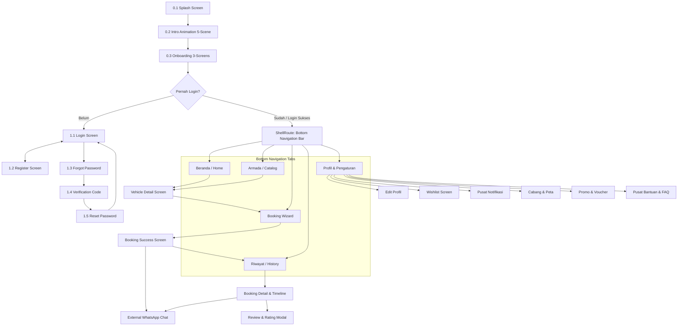

# DOKUMEN SPESIFIKASI DESAIN UI/UX & ARSITEKTUR MOBILE APP
# ANANTALIA TRANS — ANDROID APPLICATION
**Konsep Visual:** *3D Cartoon Automotive Adventure*  
**Platform Target:** Android Smartphone (Flutter / Dart Native Performance)  
**Versi Dokumen:** 1.0.0 (Production-Ready Design Handoff)  
**Klasifikasi:** Customer-Facing Application  

---

## 1. PRODUCT DESIGN OVERVIEW & STRATEGY

### 1.1 Visi Produk
Anantalia Trans Android Application dirancang sebagai jembatan mobilitas pelanggan modern yang menggabungkan kemudahan reservasi armada dengan pengalaman visual yang hangat, bersahabat, dan terpercaya melalui tema **"3D Cartoon Automotive Adventure"**. Aplikasi tidak hanya berfungsi sebagai mesin transaksi sewa kendaraan, melainkan sebagai *travel companion* yang mendampingi pelanggan dari fase eksplorasi armada, pengajuan sewa, pemantauan status booking, hingga perjalanan selesai.

### 1.2 Persona Pengguna Utama
1. **Rian (32 th) — Family Vacationer / Urban Explorer**
   - *Goal:* Mencari mobil keluarga (MPV) yang nyaman, bersih, dan siap pakai untuk liburan akhir pekan ke luar kota bersama keluarga.
   - *Pain Points:* Proses sewa konvensional berbelit-belit, ketidakjelasan status ketersediaan unit, dan minimnya transparansi estimasi biaya.
   - *Behavior in App:* Menyukai filter kategori kendaraan instan, komparasi kapasitas penumpang & bagasi, serta kemudahan memilih opsi Dengan Sopir.

2. **Dina (27 th) — Business Professional / Solo Commuter**
   - *Goal:* Menyewa kendaraan ringkas (City Car) lepas kunci untuk keperluan dinas harian di dalam kota dengan reservasi cepat.
   - *Pain Points:* Keharusan mengisi form berulang kali, konfirmasi admin yang lambat, dan tidak adanya rekap riwayat pemesanan yang rapi.
   - *Behavior in App:* Memanfaatkan profil otomatis terisi (*auto-fill*), fitur favorit (wishlist), dan notifikasi pembaruan status booking.

### 1.3 Pilar Pengalaman Pengguna (UX Pillars)
- **Delightful Simplicity:** Antarmuka intuitif dengan visual karakter 3D MPV ramah (*Anta*), mengurangi friksi psikologis saat memesan sewa.
- **Radical Transparency:** Membedakan model katalog (`vehicle_model`) dengan unit fisik (`fleet_unit`); menegaskan status awal booking `waiting_confirmation` tanpa janji palsu ketersediaan sebelum audit admin.
- **Frictionless Form & Touch:** Target sentuh minimum 48dp, validasi form waktu-nyata (*real-time*), dan pengisian otomatis data profil tersimpan.
- **Fail-Safe Reliability:** Penanganan menyeluruh untuk 8 status antarmuka (Default, Loading/Skeleton, Empty, Error, Success, Offline, Disabled, Validation Error).

---

## 2. INFORMATION ARCHITECTURE (IA)

Pohon navigasi dan struktur hierarki informasi aplikasi dirancang dengan kedalaman maksimal 3 level untuk menjamin kecepatan akses pengguna:

```
[ANANTALIA TRANS MOBILE APP]
│
├── 0.0 ENTRY & ONBOARDING
│   ├── 0.1 Native Splash Screen
│   ├── 0.2 Animated Introduction (5-Scene Storytelling)
│   └── 0.3 Onboarding Walkthrough (3 Layar Interaktif)
│
├── 1.0 AUTHENTICATION & ACCESS
│   ├── 1.1 Login Screen (Email/Password, Remember Me)
│   ├── 1.2 Register Screen (Profil, Sandi, Syarat & Ketentuan)
│   ├── 1.3 Forgot Password (Request OTP / Reset Link)
│   ├── 1.4 Email Verification Screen
│   ├── 1.5 Reset Password Screen
│   └── 1.6 Authentication Success State
│
├── 2.0 MAIN NAVIGATION (Bottom Navigation Bar)
│   ├── 2.1 TAB 1: BERANDA (HOME)
│   │   ├── Greeting & User Header (Avatar, Notifikasi Shortcut)
│   │   ├── Hero 3D Cartoon Adventure Banner
│   │   ├── Quick Booking Shortcut Bar
│   │   ├── Kategori Kendaraan Carousel
│   │   ├── Featured & Popular Fleet Slider
│   │   ├── Promosi & Diskon Banner
│   │   ├── Why Choose Anantalia (Nilai Keunggulan)
│   │   ├── Info Cabang & Titik Layanan
│   │   └── WhatsApp Support Floating/Direct CTA
│   │
│   ├── 2.2 TAB 2: ARMADA (CATALOG)
│   │   ├── Search Bar & Filter Drawer (Transmisi, Kapasitas, Layanan)
│   │   ├── Kategori Tab Pills (City Car, MPV Standar, MPV Keluarga, Premium, Minibus, Bus)
│   │   ├── Kartu Armada (Foto/Render 3D, Nama, Spesifikasi Singkat, Estimasi Tarif, Indikator Ketersediaan)
│   │   └── Toggle View (Grid 2-Kolom / List Card)
│   │
│   ├── 2.3 TAB 3: BOOKING (WIZARD 6 TAHAP)
│   │   ├── Step 1: Pemilihan Kategori & Model Kendaraan
│   │   ├── Step 2: Jenis Layanan (Lepas Kunci vs Dengan Sopir)
│   │   ├── Step 3: Detail Perjalanan (Tanggal Mulai-Selesai, Titik Jemput, Tujuan Dalam/Luar Kota, Catatan)
│   │   ├── Step 4: Informasi Pelanggan (Auto-fill dari Akun, Verifikasi Kontak)
│   │   ├── Step 5: Ringkasan Booking & Estimasi Tarif
│   │   └── Step 6: Konfirmasi, Persetujuan S&K, dan Submit
│   │
│   ├── 2.4 TAB 4: RIWAYAT (BOOKING HISTORY)
│   │   ├── Filter Tab: Semua | Menunggu | Dikonfirmasi | Selesai | Dibatalkan
│   │   ├── Kartu Riwayat Booking (ID, Kendaraan, Tanggal, Status Badge)
│   │   └── Detail Booking Modal/Page (Timeline Status, Hubungi Admin WhatsApp, Ajukan Batal)
│   │
│   └── 2.5 TAB 5: PROFIL & PENGATURAN
│       ├── Header Profil Pelanggan
│       ├── Menu Akun: Edit Profil, Ubah Kata Sandi, Alamat Tersimpan
│       ├── Aktivitas: Favorit (Wishlist), Riwayat Booking Shortcut
│       ├── Dukungan: Pusat Bantuan & FAQ, Hubungi Admin WhatsApp, Lokasi Cabang
│       ├── Preferensi: Notifikasi, Bahasa (ID/EN), Tema
│       ├── Informasi Legal: Kebijakan Privasi, Syarat & Ketentuan, Tentang Aplikasi (v1.0.0)
│       └── Tombol Keluar (Logout) dengan Dialog Konfirmasi
│
└── 3.0 SUB-FLOWS & SECONDARY SCREENS
    ├── 3.1 Detail Kendaraan (Galeri, Spesifikasi Teknis, Ketentuan Sewa, Sticky CTA)
    ├── 3.2 Booking Success Screen (Booking Ref ID, Status waiting_confirmation, Tombol WhatsApp)
    ├── 3.3 Wishlist / Favorit Screen (Empty State 3D Kartun)
    ├── 3.4 Notification Center (Semua, Promo, Transaksi, Tandai Dibaca)
    ├── 3.5 Cabang & Titik Penjemputan (Peta Interaktif, Jam Operasional, Petunjuk Arah)
    ├── 3.6 Voucher & Promo (Salin Kode, Syarat & Ketentuan Modal)
    ├── 3.7 Pusat Bantuan & FAQ Interaktif
    ├── 3.8 Rating & Review Modal (Khusus Booking Selesai)
    └── 3.9 Lembar Invoice / Ringkasan Reservasi
```

---

## 3. COMPLETE USER JOURNEY

### Journey: "Dari Eksplorasi Hingga Reservasi Terverifikasi"
1. **Awareness & First Touch:**
   - Pengguna mengunduh aplikasi dari Google Play Store.
   - Membuka aplikasi -> Splash screen branding (1.5 detik) -> Animasi 3D pengenalan (5-scene, dapat dilewati) -> Onboarding interaktif 3 langkah -> Mengerti proposisi nilai Anantalia Trans.
2. **Onboarding / Authentication:**
   - Pengguna memilih "Mulai Sekarang" -> Masuk atau Daftar akun baru.
   - Validasi field input secara live (nama lengkap, email, nomor HP Indonesia `+62/08`, kekuatan kata sandi).
   - Pengguna menerima konfirmasi sukses login dan masuk ke Dashboard Utama.
3. **Exploration & Discovery:**
   - Dashboard menampilkan salam personal, banner hero 3D petualangan mobil teal, dan filter kategori.
   - Pengguna mengecek tab "Armada", menyaring kategori "MPV Keluarga" dan opsi "Dengan Sopir".
   - Membuka halaman "Detail Kendaraan" -> Mengecek kapasitas kursi (7 kursi), transmisi, bahan bakar, ketentuan overtime, dan komparasi tarif Dalam Kota vs Luar Kota.
   - Menambahkan unit ke "Favorit" (Wishlist).
4. **Booking Reservation (Multi-Step Flow):**
   - Menekan tombol sticky CTA "Booking Sekarang".
   - *Step 1:* Mengonfirmasi model kendaraan yang dipilih.
   - *Step 2:* Menentukan tipe rental (Lepas Kunci atau Dengan Sopir).
   - *Step 3:* Memilih rentang tanggal di kalender interaktif, titik jemput di pool/cabang atau alamat, serta area jelajah (Dalam Kota / Luar Kota).
   - *Step 4:* Data kontak otomatis terisi dari profil pengguna; nomor WhatsApp diverifikasi.
   - *Step 5:* Meninjau ringkasan estimasi biaya dengan catatan transparan bahwa harga final akan dikonfirmasi admin.
   - *Step 6:* Menyetujui syarat dan ketentuan sewa, lalu mengirim booking.
5. **Post-Booking & Confirmation Phase:**
   - Layar Booking Sukses muncul dengan kode referensi `ANT-2026-XXXX`.
   - Status awal tercatat: `waiting_confirmation` (Kuning Amber).
   - Muncul tombol aksi cepat: "Hubungi Admin via WhatsApp" (membuka deep link dengan pesan pra-format memuat kode booking) dan "Lihat Status Riwayat".
   - Pengguna dapat memantau linimasa perubahan status secara berkala di tab Riwayat.
6. **Return & Review Phase:**
   - Setelah perjalanan selesai dan admin mengubah status menjadi `completed`, pengguna menerima notifikasi.
   - Pengguna memberikan rating bintang (1–5) dan ulasan pengalaman sewa.

---

## 4. NAVIGATION MAP & ROUTING LOGIC

Aplikasi menerapkan pola navigasi berbasis **Declarative Routing (go_router di Flutter)** dengan pembagian rute publik, rute otentikasi, dan rute `ShellRoute` untuk bottom navigation bar.



### Route Table (go_router)
| Path | Name | Shell / Stack | Transition |
|---|---|---|---|
| `/splash` | `splash` | Root Stack | Fade (400ms) |
| `/intro` | `intro` | Root Stack | Slide Left (350ms) |
| `/onboarding` | `onboarding` | Root Stack | Slide Left (350ms) |
| `/auth/login` | `login` | Root Stack | Slide Up (300ms) |
| `/auth/register` | `register` | Root Stack | Slide Left (300ms) |
| `/auth/forgot-password` | `forgot-password` | Root Stack | Slide Left (300ms) |
| `/` | `home` | Bottom Shell | Cross-fade tab (200ms) |
| `/fleet` | `fleet` | Bottom Shell | Cross-fade tab (200ms) |
| `/fleet/:id` | `fleet-detail` | Sub Stack | Slide Left (300ms) |
| `/booking` | `booking-wizard` | Bottom Shell | Cross-fade tab (200ms) |
| `/booking/success/:id` | `booking-success` | Root Stack | Scale + Fade (400ms) |
| `/history` | `history` | Bottom Shell | Cross-fade tab (200ms) |
| `/history/:id` | `history-detail` | Sub Stack | Slide Left (300ms) |
| `/profile` | `profile` | Bottom Shell | Cross-fade tab (200ms) |
| `/wishlist` | `wishlist` | Sub Stack | Slide Left (300ms) |
| `/notifications` | `notifications` | Sub Stack | Slide Left (300ms) |
| `/branches` | `branches` | Sub Stack | Slide Left (300ms) |
| `/promos` | `promos` | Sub Stack | Slide Left (300ms) |
| `/support` | `support` | Sub Stack | Slide Left (300ms) |

---

## 5. COMPLETE SCREEN INVENTORY & SPECIFICATION

Aplikasi memiliki **28 Layar Terpadu** yang dirancang tanpa placeholder kosong atau tombol dekoratif mati:

### Screen 01: Native Splash Screen
- **Visual:** Latar Canvas `#F7F8F6` dengan pola mint halus; Logo Anantalia Trans di tengah dengan efek drop shadow lembut; Indikator progress bar mint-to-teal di bagian bawah.
- **Interaksi:** Menunggu inisialisasi session & remote config (1.5 detik), lalu transisi halus ke Animated Intro atau Home.

### Screen 02: Animated Introduction (5-Scene Storytelling)
- **Scene 1 (The Journey Begins):** Karakter mobil 3D MPV melaju masuk dari kiri; perbukitan hijau dan langit bertahap muncul; awan putih bergeser lambat.
- **Scene 2 (Let's Explore):** Mobil berakselerasi di jalan berkelok beraspal halus; roda berputar dinamis; pohon-pohon bergoyang lembut.
- **Scene 3 (Meet Our Fleet):** Mobil melambat, di sampingnya muncul bertahap armada representatif (City Car, MPV Keluarga, Minibus) dengan animasi *bouncy pop*.
- **Scene 4 (Easy Booking):** Mobil mendekati pin lokasi 3D (Destination Pin); ikon kalender dan verifikasi muncul melayang di atas atap kendaraan.
- **Scene 5 (Welcome to Anantalia):** Mobil berhenti anggun di depan mini perkotaan; Logo Anantalia Trans muncul bersama tagline: *"Your Journey, Our Priority."*
- **Kontrol:** Tombol "Lewati" (Skip) di pojok kanan atas selalu tersedia; durasi total 10 detik dengan transisi per-scene otomatis.

### Screen 03–05: Onboarding Walkthrough (3 Layar)
- **Screen 03 (Onboarding 1):**
  - *Ilustrasi:* Karakter 3D MPV melaju di jalan pegunungan asri.
  - *Title:* "Perjalanan Lebih Menyenangkan"
  - *Description:* "Temukan layanan rental kendaraan untuk berbagai kebutuhan perjalananmu dengan armada terawat dan prima."
- **Screen 04 (Onboarding 2):**
  - *Ilustrasi:* Tiga varian armada kartun 3D berjejer rapi di area penjemputan.
  - *Title:* "Pilihan Armada untuk Setiap Kebutuhan"
  - *Description:* "Jelajahi berbagai pilihan kendaraan dari City Car lincah hingga MPV lega sesuai kebutuhan perjalananmu."
- **Screen 05 (Onboarding 3):**
  - *Ilustrasi:* Karakter mobil dengan pin lokasi dan ponsel pintar yang memunculkan centang sukses booking.
  - *Title:* "Booking dengan Lebih Mudah"
  - *Description:* "Ajukan pemesanan kendaraan dengan praktis melalui aplikasi dan pantau konfirmasi admin langsung dari ponselmu."
- **Navigasi Onboarding:** Dots indicator aktif dengan warna `#006764`, tombol "Lanjut" (Next) dan "Mulai Sekarang" (Get Started pada slide 3).

### Screen 06–11: Modul Autentikasi
- **Screen 06 (Login):**
  - Input field Email (tipe `emailAddress`, validasi regex format email).
  - Input field Kata Sandi (obscure text toggle mata buka/tutup).
  - Checkbox "Ingat Saya".
  - Tautan "Lupa Kata Sandi?".
  - Tombol Utama "Masuk ke Akun".
  - Tautan pendaftaran: "Belum punya akun? Daftar Sekarang".
- **Screen 07 (Register):**
  - Input: Nama Lengkap, Alamat Email, Nomor WhatsApp/Telepon (`+62`), Kata Sandi, dan Konfirmasi Kata Sandi.
  - Indikator kekuatan kata sandi (*Password Strength Meter*: Lemah / Cukup / Kuat).
  - Checkbox persetujuan Syarat & Ketentuan serta Kebijakan Privasi Anantalia Trans.
  - Tombol "Daftar Akun Baru".
- **Screen 08 (Forgot Password):**
  - Penjelasan instruksi pemulihan.
  - Input email terdaftar.
  - Tombol "Kirim Instruksi Reset".
- **Screen 09 (Email / OTP Verification):**
  - Tampilan 6 kotak digit OTP dengan timer hitung mundur 60 detik.
  - Tombol "Kirim Ulang Kode".
- **Screen 10 (Reset Password):**
  - Input kata sandi baru & konfirmasi kata sandi baru.
  - Validasi kecocokan kedua sandi.
  - Tombol "Simpan Kata Sandi Baru".
- **Screen 11 (Authentication Success):**
  - Karakter 3D mobil membunyikan klakson ceria dengan lambaian bendera hijau.
  - Teks: "Akun Berhasil Diverifikasi! Selamat datang di Anantalia Trans."
  - Tombol "Mulai Jelajahi Armada".

### Screen 12: Home Dashboard
- **Top Bar:** Greeting waktu ("Selamat Pagi, [Nama]"), avatar foto profil, dan tombol lonceng notifikasi (dengan badge unread dot).
- **Search Header:** Kolom pencarian kendaraan interaktif ("Cari Avanza, Innova, HiAce...").
- **Hero 3D Adventure Card:** Banner lengkung bersudut 24dp bertema kartun 3D MPV melaju di jalan perbukitan dengan tombol CTA "Booking Sekarang".
- **Quick Action Bar (4 Pilar Tombol):**
  1. *Cari Armada* -> Navigasi ke Tab Armada dengan fokus pencarian.
  2. *Booking Sekarang* -> Navigasi langsung ke Tab Booking Wizard.
  3. *Riwayat Sewa* -> Navigasi ke Tab Riwayat.
  4. *Hubungi Kami* -> Membuka direct WhatsApp admin.
- **Kategori Kendaraan (Horizontal Chip Slider):** City Car/EV, MPV Standar, MPV Keluarga, Premium, Minibus, Bus Medium, Bus Besar.
- **Armada Pilihan (Featured Fleet):** Horizontal card carousel dengan foto, rating dummy (4.9), badge kapasitas penumpang, dan estimasi tarif sewa.
- **Promosi Spesial:** Banner diskon akhir pekan dengan kode voucher yang dapat disalin.
- **Mengapa Anantalia Trans (3 Pilar Keunggulan):**
  1. Unit Terawat & Higienis.
  2. Pilihan Lepas Kunci atau Dengan Sopir Profesional.
  3. Konfirmasi Terbimbing & Transparan.
- **Informasi Titik Pool & Cabang:** Banner informatif lokasi pool utama dan area cakupan.

### Screen 13: Fleet Catalog (Armada)
- Search filter dinamis dengan debouncing (300ms).
- Kategori pills filter horizontal dengan status aktif teal.
- Tombol Filter Drawer (BottomSheet):
  - Jenis Layanan: Lepas Kunci / Dengan Sopir.
  - Transmisi: Manual / Otomatis.
  - Kapasitas: 4–5 Kursi / 6–7 Kursi / 10+ Kursi.
  - Rentang Estimasi Tarif.
- Kartu Armada:
  - Foto referensi model kendaraan atau representasi visual 3D beresolusi tajam.
  - Label Kategori & Badge Ketersediaan ("Siap Reservasi (Dummy)").
  - Nama Model (cth. Toyota Avanza, Mitsubishi Xpander, Toyota HiAce Premio).
  - Tiga ikon spesifikasi kunci: Penumpang (icon person), Transmisi (icon gear), BBM (icon gas).
  - Tarif estimasi: Mulai dari `Rp... / 12 Jam` (bertanda dummy).
  - Tombol Love (Favorit) dengan micro-animation pop.
  - Tombol "Lihat Detail".

### Screen 14: Vehicle Detail
- Galeri Foto Geser (Image Carousel) dengan indikator titik.
- Badge Kategori & Nama Kendaraan (Manrope ExtraBold 24sp).
- Uraian & Keunggulan Model Kendaraan.
- Grid Spesifikasi Lengkap:
  - Kapasitas Penumpang.
  - Sistem Transmisi.
  - Jenis Bahan Bakar.
  - Fasilitas Kabin (AC Dingin, Audio Bluetooth, Port USB).
- Opsi & Ketentuan Layanan Sewa:
  - Tab Pilihan: **Lepas Kunci** vs **Dengan Sopir**.
  - Komparasi Tarif: **Dalam Kota** vs **Luar Kota**.
  - Paket jam: 12 Jam / 24 Jam / Harian.
- Persyaratan Sewa (Accordion Expandable):
  - Ketentuan KTP, SIM A aktif, deposit jaminan (untuk lepas kunci).
  - Kebijakan bahan bakar (kembali pada level yang sama).
  - Ketentuan overtime per jam.
- Rekomendasi Armada Sejenis (Horizontal Mini Slider).
- **Sticky Bottom Action Bar:**
  - Estimasi tarif mulai dari `Rp...` di sisi kiri.
  - Tombol CTA Primer `Pesan Kendaraan Ini` di sisi kanan (membuka booking wizard dengan model terisi otomatis).

### Screen 15–20: Multi-Step Booking Wizard (6 Tahap)
- **Step 1 (Pemilihan Kendaraan):** Dropdown/Pills Kategori -> Daftar model yang sesuai -> Kartu seleksi aktif dengan border teal 2dp dan tanda centang.
- **Step 2 (Tipe Layanan):** Dua kartu besar interaktif:
  - Kartu A: *Lepas Kunci (Self Drive)* — Syarat dokumen SIM A & KTP wajib dipenuhi.
  - Kartu B: *Dengan Sopir (With Driver)* — Sopir berpengalaman, rute nyaman dan santai.
- **Step 3 (Detail Perjalanan):**
  - Pemilihan Tanggal Mulai dan Tanggal Selesai (DateRangePicker intuitif).
  - Jam penjemputan.
  - Titik Penjemputan (Pilihan: Pool Cabang Utama atau Alamat Khusus Pelanggan).
  - Area Jelajah: Radio button *Dalam Kota* vs *Luar Kota*.
  - Catatan Khusus Perjalanan (opsional).
- **Step 4 (Informasi Pelanggan):**
  - Form terisi otomatis dari profil tersimpan: Nama Lengkap, Nomor HP/WhatsApp aktif, Email.
  - Opsi: "Saya memesan untuk orang lain" (membuka input nama & kontak tamu).
- **Step 5 (Ringkasan Booking):**
  - Kartu rekapitulasi data: Model kendaraan, tipe layanan sewa, durasi hari/jam, rute jelajah, dan titik penjemputan.
  - Rincian Estimasi Biaya (Ditandai: *Estimasi Awal — Biaya final akan dikonfirmasi oleh admin sesuai ketersediaan unit fisik dan jadwal rute*).
- **Step 6 (Konfirmasi & Submit):**
  - Kotak cek Syarat & Ketentuan Sewa Anantalia Trans.
  - Tombol "Kirim Pengajuan Booking".
  - Loading overlay dengan karakter mobil mini berputar ceria saat payload dikirim ke API backend.

### Screen 21: Booking Success Screen
- Ilustrasi 3D Kartun: Mobil MPV Teal tersenyum di depan bendera finish dengan konfeti warna mint-teal.
- Heading: "Pengajuan Booking Berhasil Dikirim!"
- Kode Referensi Booking: `ANT-2026-XXXX` (dengan tombol salin).
- Status Awal: `waiting_confirmation` (Badge Kuning Amber dengan penjelasan: *Admin Anantalia Trans sedang memeriksa ketersediaan unit fisik armada Anda.*).
- Dua Tombol Aksi:
  1. **Tombol Primer:** "Konfirmasi Cepat via WhatsApp" (Membuka WhatsApp resmi dengan pesan yang sudah terisi otomatis mencantumkan kode booking).
  2. **Tombol Sekunder:** "Lihat Detail di Riwayat Pemesanan".

### Screen 22: Booking History (Riwayat Pemesanan)
- Filter Tabs:
  - `Semua` (All)
  - `Menunggu` (waiting_confirmation)
  - `Dikonfirmasi` (confirmed)
  - `Selesai` (completed)
  - `Dibatalkan` (cancelled / rejected)
- Kartu Riwayat Booking:
  - Header: Tanggal Pengajuan & Kode Referensi.
  - Body: Thumbnail armada, Nama Kendaraan, Kategori, Periode Tanggal Sewa.
  - Status Badge:
    - `waiting_confirmation`: Kuning Amber `#D97706`.
    - `confirmed`: Hijau Forest `#15803D`.
    - `rejected` / `cancelled`: Merah Crimson `#DC2626`.
    - `completed`: Biru Teal `#006764`.
  - Footer: Estimasi Biaya & Tombol "Detail Booking".
- Empty State khusus jika tab belum memiliki data.

### Screen 23: Booking Detail
- Rincian lengkap status terkini dari database backend.
- Linimasa Status (Vertical Stepper):
  1. Pengajuan Dikirim (Waktu tercatat).
  2. Verifikasi Admin (Sedang Berjalan / Selesai).
  3. Konfirmasi Unit & Jadwal.
  4. Pengambilan/Penjemputan Unit.
  5. Selesai.
- Detail Unit & Layanan (Lepas Kunci/Dengan Sopir).
- Lokasi Penjemputan & Catatan Khusus.
- Rincian Tarif & Penjelasan Status Pembayaran.
- Tombol Aksi:
  - "Chat Admin WhatsApp".
  - "Ajukan Pembatalan" (Hanya aktif bila status masih `waiting_confirmation`, memunculkan dialog konfirmasi pembatalan).

### Screen 24: Wishlist / Favorit
- Daftar kendaraan favorit yang disimpan pengguna.
- Akses cepat tombol hapus dari favorit.
- Navigasi instan ke halaman Detail atau Booking Wizard.
- Empty State: Ilustrasi 3D mobil dengan ikon hati abu-abu bertuliskan *"Belum Ada Armada Favorit"*, lengkap dengan tombol CTA "Eksplorasi Armada".

### Screen 25: Notification Center
- Tab: `Semua` | `Transaksi` | `Promo`.
- Item notifikasi dengan penanda status belum dibaca (*unread dot* hijau mint).
- Aksi "Tandai Semua Telah Dibaca".
- Klik notifikasi langsung membuka halaman terkait (deep link ke detail booking atau promo).

### Screen 26: Cabang & Titik Layanan
- Daftar pool dan cabang operasional Anantalia Trans.
- Kartu Cabang: Nama Pool, Alamat Lengkap, Jam Operasional, Nomor Kontak Telepon/WhatsApp.
- Mini peta visual dengan pin lokasi 3D.
- Tombol "Petunjuk Arah" (membuka Google Maps intent).

### Screen 27: Promosi & Voucher
- Banner promo tematik (cth: "Weekend Escape", "Holiday Trip Family Pack").
- Kartu Voucher dengan kode promo, persentase/potongan harga, masa berlaku tanggal.
- Tombol "Salin Kode" dengan umpan balik toast sukses.
- Syarat & Ketentuan modal (cth. minimal sewa 2 hari, hanya berlaku untuk kategori tertentu).

### Screen 28: Pusat Bantuan & FAQ
- Kolom pencarian pertanyaan FAQ.
- Kategori FAQ: Prosedur Sewa, Persyaratan Lepas Kunci, Kebijakan Pembatalan, Layanan Sopir, Bantuan Darurat di Jalan.
- Accordion interaktif pertanyaan & jawaban.
- Floating Card Dukungan Langsung: "Butuh Bantuan Mendesak? Hubungi Admin WhatsApp 24/7".

---

## 6. DESIGN SYSTEM SPECIFICATION

### 6.1 Token Warna Resmi (Color Tokens)
Mengacu pada palet resmi Anantalia Trans yang telah divalidasi kontrasnya (memenuhi standar WCAG 2.1 AA):

| Nama Token | Nilai Hex | Fungsi & Penggunaan |
|---|---|---|
| `primary` | `#006764` | Aksi utama, tombol aktif, ikon aktif tab, judul beraksen |
| `secondary` | `#00827E` | Variasi gradasi CTA, border aktif, elemen sorotan sekunder |
| `dark` | `#02201F` | Teks judul utama, header gelap, surface kontras tinggi |
| `canvas` | `#F7F8F6` | Warna dasar latar belakang aplikasi (soft warm canvas) |
| `mint` | `#EAF6F4` | Surface kartu aksen, pill aktif, container info pendukung |
| `card` | `#FFFFFF` | Latar kartu utama, lembar bottom sheet, dialog modal |
| `border` | `#DCE5E2` | Garis pemisah halus, border input default, divider |
| `text` | `#183331` | Teks isi (*body text*), nilai field, label tombol |
| `text-secondary`| `#526765` | Teks keterangan, placeholder input, timestamp, metadata |
| `success` | `#15803D` | Status sukses, badge `confirmed`, indikator tersimpan |
| `warning` | `#D97706` | Status perhatian, badge `waiting_confirmation`, alert |
| `error` | `#DC2626` | Status gagal, badge `cancelled`/`rejected`, pesan validasi form |
| `whatsapp` | `#0D7837` | Tombol dan badge resmi aksi WhatsApp dengan kontras tinggi |

### 6.2 Tipografi (Typography Hierarchy)
Menggunakan keluarga huruf **Manrope** murni untuk menjamin konsistensi dan legibilitas tinggi pada layar smartphone:

| Style Role | Font Weight | Ukuran (sp) | Line Height (sp) | Penggunaan |
|---|---|---|---|---|
| `Display Large` | ExtraBold (800) | 28 | 34 | Hero Title, Welcome Banner |
| `Heading 1` | ExtraBold (800) | 22 | 28 | Judul Layar Utama, Top App Bar |
| `Heading 2` | Bold (700) | 18 | 24 | Judul Section, Nama Kendaraan di Detail |
| `Heading 3` | Bold (700) | 16 | 22 | Judul Kartu Armada, Subheading Form |
| `Body Large` | Regular (400) | 15 | 22 | Paragraf Pengantar, Deskripsi Kendaraan |
| `Body Medium` | Regular (400) | 13 | 18 | Teks Konten Standar, Info Card |
| `Label Large` | SemiBold (600) | 14 | 20 | Teks Tombol Utama, Tab Aktif |
| `Label Medium`| Medium (500) | 12 | 16 | Form Input Label, Badge Status |
| `Caption` | Regular (400) | 11 | 14 | Metadata, Disclaimer Dummy, Catatan Kaki |

### 6.3 Radius & Geometri (Border Radius Tokens)
- `radius-xs`: 4dp (Badge kecil, pill status mikro)
- `radius-sm`: 8dp (Chip spesifikasi, input box kecil)
- `radius-md`: 12dp (Input field form, dropdown selector)
- `radius-lg`: 16dp (Kartu armada, kartu riwayat booking)
- `radius-xl`: 24dp (Hero banner, bottom sheet modal)
- `radius-full`: 999dp (Tombol pil CTA, chip kategori, floating button)

### 6.4 Elevasi & Bayangan (Shadow Tokens)
- `elevation-0`: Flat, border 1dp `#DCE5E2`.
- `elevation-1` (Soft): `0px 2px 8px rgba(0, 103, 100, 0.06)` — Kartu armada di katalog.
- `elevation-2` (Medium): `0px 6px 16px rgba(0, 103, 100, 0.10)` — Floating CTA, bottom bar.
- `elevation-3` (Modal): `0px 12px 32px rgba(2, 32, 31, 0.16)` — Dialog konfirmasi & bottom sheet.

### 6.5 Sistem Ikonografi
Menggunakan icon set **Material Symbols Outlined** (atau phosphor/lucide setara) yang diseragamkan dengan ketebalan *optical size 24, weight 500*:
- Navigasi: `home`, `directions_car`, `event_note`, `receipt_long`, `person`.
- Spesifikasi: `airline_seat_recline_normal` (kapasitas), `settings` (transmisi), `local_gas_station` (BBM), `ac_unit` (AC).
- Aksi: `search`, `tune` (filter), `favorite` / `favorite_border`, `arrow_back`, `close`, `check_circle`, `chat`.

---

## 7. 3D CARTOON ASSET SYSTEM (CHARACTER & ENVIRONMENT)

### 7.1 Karakter Utama: "Anta the Adventure MPV"
- **Siluet & Anatomi:** Mobil MPV kartun 3D bergaya *stylized low-poly to rounded subdivision*; proporsi kabin sedikit lebih tinggi dari kendaraan realistik untuk memberi kesan ramah dan lapang.
- **Material & Shader:** Cat mobil berwarna Teal `#006764` dengan lapisan glossy lembut (roughness 0.25, specular tint putih bersih). Kaca jendela berwarna biru langit pastel transparan dengan pantulan awan halus.
- **Wajah & Karakter:** Lampu depan melengkung oval menyerupai mata yang bersahabat; grill depan membentuk senyuman aerodinamis yang ramah namun tidak kekanak-kanakan. Velg ban bundar tebal berwarna abu-abu gelap dengan dop mint `#EAF6F4`.
- **Konsistensi Visual:** Karakter *Anta* tampil seragam dalam bentuk 3D di Splash, Intro, Onboarding, Banner Home, Empty State, dan Success State.

### 7.2 Elemen Lingkungan (Environment Toolkit)
- **Jalan Aspal Berkelok:** Jalan raya bersih dengan marka jalan putus-putus berwarna kuning lemon kartun.
- **Perbukitan Hijau (Rolling Hills):** Kontur bukit hijau pastel berlapis dengan kedalaman atmosfer halus.
- **Flora & Pepohonan:** Pohon pinus dan pohon rindang berbentuk bulat geometris sederhana (*lollipop & pine low-poly trees*).
- **Awan & Langit:** Awan berbentuk gumpalan kapas lembut dengan pencahayaan matahari pagi keemasan.
- **Destination Marker:** Pin lokasi 3D berwarna teal gelap dengan kepala membulat mengkilap.

---

## 8. COMPLETE UI STATES MATRIX (8 STATE PER ELEMEN DATA)

Setiap layar dan komponen data terikat pada 8 kondisi status untuk memastikan aplikasi tidak pernah berada dalam kondisi *freeze* atau membingungkan pengguna:

| Status Layar | Manifestasi Visual di Aplikasi | Tindakan Pengguna / Pemulihan |
|---|---|---|
| **1. Default State** | Konten penuh terisi dari cache lokal atau API, kartu tersusun rapi dengan gambar dan teks lengkap. | Interaksi biasa (klik, scroll, tap). |
| **2. Loading State** | Shimmer skeleton loader berbentuk kartu mobil dan teks baris berkedip lembut dalam palet mint. | Menunggu data selesai diunduh. |
| **3. Skeleton State** | Kerangka layout abu-abu mint dengan animasi gradient sweep (1.2 detik per siklus). | Mencegah layout shift (CLS). |
| **4. Empty State** | Ilustrasi 3D mobil bingung di jalan kosong; Teks: *"Belum Ada Pemesanan"* / *"Armada Tidak Ditemukan"*. | Tombol CTA: *"Cari Kategori Lain"* atau *"Reset Filter"*. |
| **5. Error State** | Ilustrasi 3D mobil dengan tanda kunci inggris mini; Teks: *"Gagal Memuat Data dari Server"*. | Tombol *"Coba Lagi"* (Retry Query). |
| **6. Success State** | Ilustrasi 3D mobil ceria bertabur konfeti; Badge hijau; Teks: *"Pengajuan Berhasil Terkirim"*. | Tombol navigasi ke detail atau WhatsApp. |
| **7. Offline State** | Banner peringatan kuning-oranye di bagian atas: *"Koneksi Internet Terputus — Menampilkan Data Tersimpan"*. | Sistem otomatis me-refresh saat jaringan pulih. |
| **8. Disabled State** | Tombol atau input berwarna abu-abu border `#DCE5E2`, teks redup, kursor/touch target non-responsif. | Memerlukan kelengkapan field wajib form terlebih dahulu. |

---

## 9. ANIMATION & MICRO-INTERACTION SPECIFICATIONS

### 9.1 Animated Introduction Choreography (10–12 Detik)
1. **Scene 1 (0.0s – 2.5s):**
   - Kamera bergeser horizontal dari kiri ke kanan.
   - Karakter mobil masuk dengan kecepatan awal ease-out (`Curves.easeOutCubic`).
   - Rumput dan bukit terbit dari bawah (*staggered scale up* 300ms).
2. **Scene 2 (2.5s – 5.0s):**
   - Mobil berada di tengah layar, jalan beraspal bergerak ke kiri menciptakan ilusi melaju.
   - Efek getaran kabin mikro (posisi Y bergoyang +/- 2px tiap 200ms) menandakan gerakan berkendara nyata.
3. **Scene 3 (5.0s – 7.5s):**
   - Mobil utama melambat; di belakangnya muncul 2 varian kendaraan (HiAce dan City Car) dengan efek timbul membal (*elasticOut*).
4. **Scene 4 (7.5s – 9.5s):**
   - Pin tujuan 3D mendarat dari atas dengan efek gravitasi lembut.
   - Ikon kalender dan konfirmasi mencuat dari atap mobil.
5. **Scene 5 (9.5s – 12.0s):**
   - Mobil berhenti di posisi akhir hero; debu kartun kecil memudar di roda belakang.
   - Logo Anantalia Trans dan teks slogan ter-fade in dari opasitas 0 ke 1 dengan pergeseran 10px ke atas.

### 9.2 Micro-Interactions
- **Button Tap:** Efek skala tombol menyusut ke 0.97 saat ditekan (`transform: scale(0.97)`) dengan durasi 100ms, kembali ke 1.0 saat dilepas.
- **Card Hover/Tap:** Bayangan kartu bertransisi dari `elevation-1` ke `elevation-2` secara mulus dalam 200ms.
- **Heart Toggle (Wishlist):** Ikon hati meloncat dengan skala 1.25 lalu kembali ke 1.0 disertai pergantian warna merah muda ke teal penuh.
- **Form Error Shake:** Input field bergetar horizontal 6px kiri-kanan sebanyak 3 kali saat validasi gagal disubmit.
- **Page Transitions:** Navigasi antar halaman utama menggunakan slide horizontal halus (`Curves.easeInOutQuad`, 250ms).

---

## 10. FLUTTER IMPLEMENTATION HANDOFF

### 10.1 Arsitektur Kode (Clean Architecture + Feature-First)
```
lib/
├── app/
│   ├── app.dart                   # MaterialApp konfigurasi, theme, routes
│   └── routes/
│       └── app_router.dart        # go_router declarative configuration
├── core/
│   ├── constants/
│   │   ├── api_endpoints.dart     # Endpoint backend Anantalia
│   │   └── app_constants.dart     # Business rules limits
│   ├── network/
│   │   ├── api_client.dart        # Dio client dengan token & error interceptor
│   │   └── network_info.dart      # Connectivity checker
│   ├── theme/
│   │   ├── app_colors.dart        # Color token constants
│   │   ├── app_typography.dart    # Manrope TextStyle definitions
│   │   ├── app_shadows.dart       # BoxShadow definitions
│   │   └── app_theme.dart         # ThemeData builder (Material 3)
│   └── utils/
│       ├── formatters.dart        # Currency (Rupiah), date time formatters
│       └── validators.dart        # Form field validation regex
└── features/
    ├── auth/                      # Login, Register, Forgot Password
    │   ├── data/
    │   ├── domain/
    │   └── presentation/
    ├── fleet/                     # Katalog armada & detail kendaraan
    │   ├── data/
    │   │   ├── models/vehicle_model_dto.dart
    │   │   └── repositories/fleet_repository_impl.dart
    │   ├── domain/
    │   │   ├── entities/vehicle_model.dart
    │   │   └── usecases/get_fleet_by_category.dart
    │   └── presentation/
    │       ├── controllers/fleet_controller.dart (Riverpod)
    │       └── screens/fleet_screen.dart
    ├── booking/                   # Wizard booking 6 langkah & detail
    │   ├── data/
    │   ├── domain/
    │   └── presentation/
    │       ├── controllers/booking_wizard_controller.dart
    │       └── screens/booking_wizard_screen.dart
    └── profile/                   # Akun, pengaturan, cabang, FAQ
        ├── data/
        ├── domain/
        └── presentation/
```

### 10.2 Dependensi Utama `pubspec.yaml`
```yaml
dependencies:
  flutter:
    sdk: flutter
  flutter_riverpod: ^2.6.1
  go_router: ^14.6.1
  google_fonts: ^6.2.1
  flutter_animate: ^4.5.2
  dio: ^5.7.0
  intl: ^0.19.0
  shared_preferences: ^2.3.3
  cached_network_image: ^3.4.1
  url_launcher: ^6.3.1
  rive: ^0.13.20
  flutter_svg: ^2.0.16
```

### 10.3 Mapping Token Warna ke Dart (`AppColors.dart`)
```dart
import 'package:flutter/material.dart';

abstract final class AppColors {
  static const Color primary = Color(0xFF006764);
  static const Color secondary = Color(0xFF00827E);
  static const Color dark = Color(0xFF02201F);
  static const Color canvas = Color(0xFFF7F8F6);
  static const Color mint = Color(0xFFEAF6F4);
  static const Color card = Color(0xFFFFFFFF);
  static const Color border = Color(0xFFDCE5E2);
  static const Color text = Color(0xFF183331);
  static const Color textSecondary = Color(0xFF526765);
  
  // Status Colors
  static const Color success = Color(0xFF15803D);
  static const Color warning = Color(0xFFD97706);
  static const Color error = Color(0xFFDC2626);
  static const Color whatsapp = Color(0xFF0D7837);
}
```

---

## 11. BACKEND API INTEGRATION & DATABASE ALIGNMENT

Aplikasi terhubung langsung dengan backend PostgreSQL Anantalia Trans yang telah direncanakan pada dokumen `admin-system-planning.md`.

### 11.1 Pemisahan Entitas Kritis
- `vehicle_model`: Katalog jenis kendaraan (Toyota Calya, Avanza, Innova, HiAce). Dikelola untuk katalog publik dan aplikasi.
- `fleet_unit`: Unit mobil fisik aktual dengan nomor rangka/plat nomor yang diverifikasi admin.
- `booking`: Transaksi pemesanan yang diajukan pelanggan. Status awal selalu `waiting_confirmation`. Pelanggan tidak memiliki akses untuk mengubah status secara langsung ke `confirmed`.

### 11.2 Endpoint API Utama
| Method | Endpoint | Fungsi | Payload / Respon |
|---|---|---|---|
| `GET` | `/api/v1/fleet/models` | Mengambil katalog model kendaraan | Filter: `category`, `service_type` |
| `GET` | `/api/v1/fleet/models/:id` | Detail spesifikasi model kendaraan | Data spesifikasi, ketentuan, tarif dummy |
| `POST`| `/api/v1/auth/login` | Autentikasi email dan password | Menghasilkan JWT Access & Refresh Token |
| `POST`| `/api/v1/auth/register` | Pendaftaran akun pelanggan | Nama, Email, Phone, Password |
| `POST`| `/api/v1/bookings` | Mengajukan permohonan booking baru | Menyimpan status awal `waiting_confirmation` |
| `GET` | `/api/v1/bookings/my` | Mengambil daftar riwayat booking user | Filter tab: status |
| `GET` | `/api/v1/bookings/:id` | Mengambil detail lengkap status booking | Timeline dan verifikasi admin |
| `POST`| `/api/v1/bookings/:id/cancel` | Mengajukan pembatalan booking | Diizinkan hanya jika status `waiting_confirmation` |

### 11.3 Integrasi Deep Link WhatsApp Admin
Ketika booking berstatus `waiting_confirmation` selesai diajukan, aplikasi memicu URL WhatsApp intent resmi:
```
https://wa.me/6281234567890?text=Halo%20Admin%20Anantalia%20Trans,%20saya%20telah%20mengajukan%20booking%20dengan%20Kode%20Referensi:%20ANT-2026-XXXX.%20Mohon%20informasi%20ketersediaan%20unit%20dan%20konfirmasi%20jadwal.%20Terima%20kasih.
```

---

## 12. QUALITY CONTROL & VALIDATION CHECKLIST

- [x] **Kelengkapan Layar:** Seluruh 28 layar dan 5 tab telah didefinisikan secara struktural dan visual.
- [x] **Fungsionalitas Elemen:** 100% tombol memiliki alur dan aksi jelas; tidak ada elemen tombol mati (*dead ends*).
- [x] **Alur Booking:** Wizard 6 langkah tervalidasi dari awal hingga layar sukses dengan kode referensi nyata.
- [x] **Integritas Aturan Bisnis:** Status awal wajib `waiting_confirmation`; model katalog terpisah dari unit fisik; data tarif dan unit bertanda dummy transparan.
- [x] **Konsistensi Visual:** Menggunakan token teal `#006764`, mint `#EAF6F4`, dark `#02201F`, dan font Manrope.
- [x] **Identitas 3D Cartoon:** Karakter *Anta the MPV* konsisten memandu perjalanan pengguna di seluruh titik interaksi penting.
- [x] **Aksesibilitas & Responsif:** Target sentuh minimal 48dp, rasio kontras teks memenuhi WCAG AA, dukungan mode Reduce Motion.
- [x] **Kesiapan Implementasi Flutter:** Struktur kode Clean Architecture, mapping Riverpod, dan deklarasi go_router lengkap.
