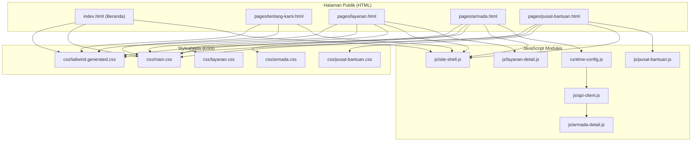

# Phase 1 — Project Inventory & Dependency Map

## 1. Struktur Direktori & File Utama (Public Website)

| Kategori | File / Path | Peran & Tanggung Jawab |
| :--- | :--- | :--- |
| **HTML (Halaman Publik)** | `index.html` | Halaman **Beranda** (Hero, Quick Trust Bar, 4 Layanan Utama, 4 Armada Unggulan, 3 Pilar Komitmen, Profil Singkat, 3 Langkah Konsultasi, Closing CTA). |
| | `pages/tentang-kami.html` | Halaman **Tentang Kami** (Breadcrumb, Metrik Ketepatan Waktu, Narasi & Mosaik Foto, Visi & Misi, 3 Pilar Nilai Layanan, Galeri Inspeksi, Notice Legalitas, Closing CTA). |
| | `pages/layanan.html` | Halaman **Layanan** (Hero, Filter Tab 5 Kategori, 4 Kartu Layanan dengan Modal Detail `#service-detail-modal`, 4 Langkah Persiapan Booking, Kotak Salin Format Chat, CTA Kemitraan). |
| | `pages/armada.html` | Halaman **Armada** (Hero & Snapshot 63 Entri, Notice Dummy Data, Live Search `#fleet-search-input`, Filter Kapasitas/Transmisi/Kategori, Grid Katalog Dinamis `#fleet-cards-container`, Modal Detail `#vehicle-detail-modal`, Form Permintaan Booking). |
| | `pages/pusat-bantuan.html` | Halaman **Pusat Bantuan** (Hero, Accordion 5 FAQ `#faq-accordion-group`, Kartu Hubungi Kami, Peta Interaktif 22 Titik Area Indonesia `#cabang-kami` dengan Zoom/Pan/Filter/Search, Modal Lokasi `#selected-city-modal`). |
| **CSS & Design System** | `css/tailwind.input.css` | Entry point direktif `@tailwind base; @tailwind components; @tailwind utilities;`. |
| | `css/tailwind.generated.css` | Stylesheet hasil kompilasi Tailwind CSS v3.4.17 (lokal tanpa CDN). |
| | `css/main.css` | Aturan global lintas halaman: `[hidden] { display: none !important; }`, kontras `.bg-whatsapp-green`, animasi motion, skala tipografi mobile (`@media (max-width: 820px)`), dan stabilitas header/drawer mobile (`@media (max-width: 1023px)`). |
| | `css/layanan.css` | Styling khusus halaman Layanan & `<dialog id="service-detail-modal">`. |
| | `css/armada.css` | Styling khusus halaman Armada, kartu katalog, filter spesifikasi, `<dialog id="vehicle-detail-modal">`, dan form booking request. |
| | `css/pusat-bantuan.css` | Styling khusus halaman Pusat Bantuan, FAQ, kanvas peta interaktif `.indonesia-map`, kontrol zoom, dan `#selected-city-modal`. |
| **JavaScript** | `js/tailwind-config.js` | Konfigurasi token desain *Serene Transit* (palet warna, font Manrope, ukuran teks, spacing, radius, shadow) dan daftar `content` untuk kompilasi Tailwind. |
| | `js/site-shell.js` | Script shell bersama di semua halaman: menyembunyikan link WhatsApp yang belum dikonfirmasi (`a[href*="wa.me"]`), mengelola tombol `#scrollToTopBtn`, serta membangun dan mengendalikan drawer `#mobile-navigation`. |
| | `js/layanan-detail.js` | Mengelola pembukaan/penutupan modal `<dialog id="service-detail-modal">` pada halaman Layanan. |
| | `js/api-client.js` | Klien HTTP `window.AnantaliaApi` untuk mengambil katalog publik (`/api/v1/public/rental-types`) dan mengirim permintaan booking (`POST /api/v1/public/booking-requests`). |
| | `js/armada-detail.js` | Merender katalog armada dari API, mengelola pencarian/filter/toggle tampilan, modal detail kendaraan `#vehicle-detail-modal`, serta form permintaan pemesanan (`#vehicle-booking-request-form`) beserta validasinya. |
| | `js/pusat-bantuan.js` | Mengelola interaksi accordion FAQ (`.faq-item`, `.faq-trigger`) dan animasi `.reveal-on-scroll`. |
| | `runtime-config.js` | Konfigurasi runtime `window.ANANTALIA_API_BASE_URL` (disajikan dinamis oleh `scripts/serve.js` dan tersedia sebagai file fallback statis di root). |
| **Data & Aset** | `fleet.json` | Arsip data dummy prototipe (63 model kendaraan dengan `"isDummy": true`). Tidak dimuat langsung oleh halaman publik (halaman publik memuat dari API terverifikasi). |
| | `logo.png` | Logo resmi Anantalia Trans (digunakan pada header dan footer seluruh halaman). |
| | `assets/indonesia-silhouette.svg` | Aset vektor siluet peta kepulauan Indonesia pada halaman Pusat Bantuan. |
| **Server & Pengujian** | `scripts/serve.js` | Server HTTP lokal (`127.0.0.1:4173`) dengan dukungan proxy `/api/*` ke `127.0.0.1:3000`. |
| | `tests/stabilization.js` | Pengujian otomatis integritas `fleet.json`, absennya Tailwind CDN, dan kelengkapan seluruh token class CSS terkompilasi. |
| | `tests/validate.ps1` | Script validasi PowerShell untuk struktur shell, path lokal, fragmen anchor, keunikan ID HTML, keseimbangan kurung kurawal CSS, dan sintaks JS. |

---

## 2. Peta Dependensi Antarhalaman & Komponen

